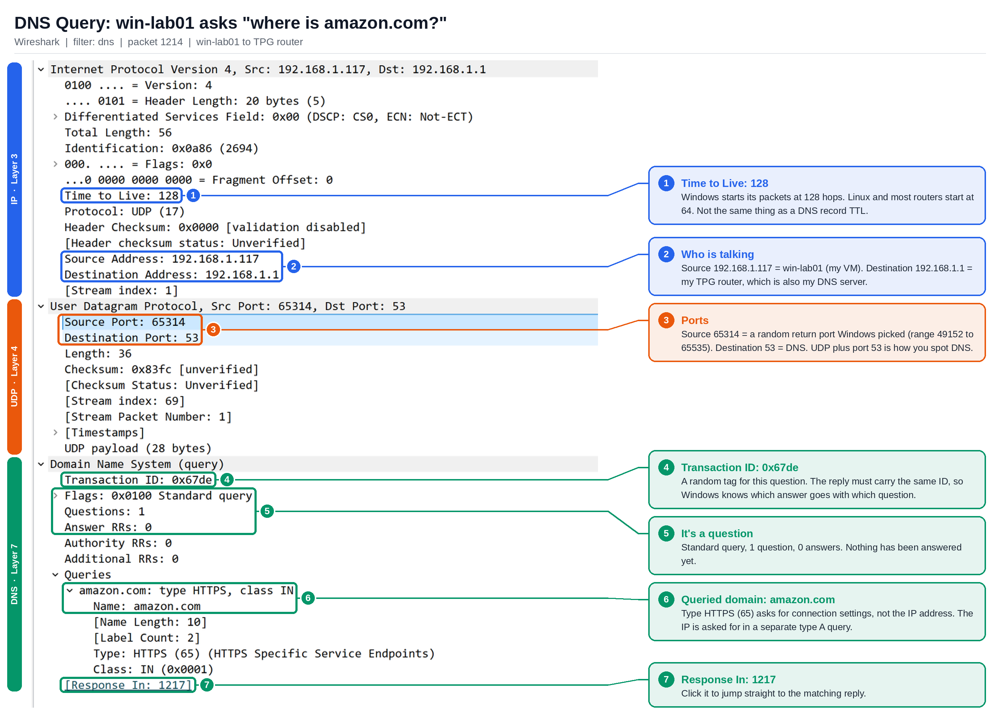
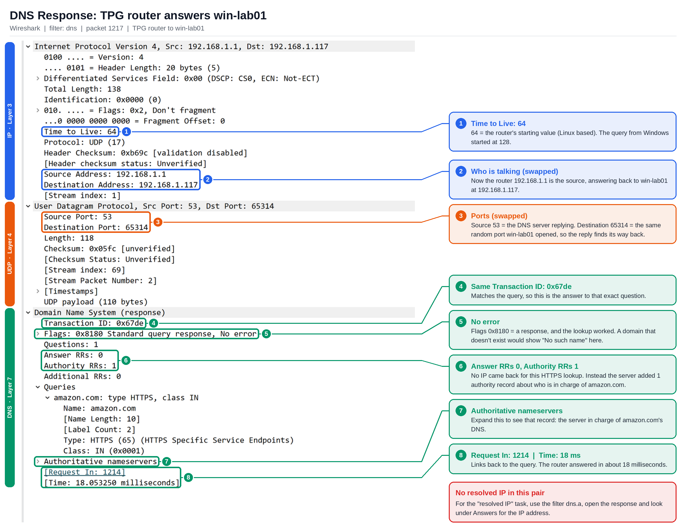
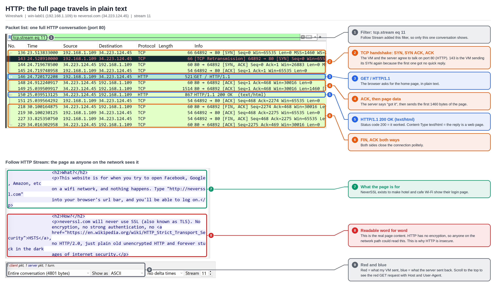

# Week 2: Networking Basics

Lab machine: **win-lab01** (Windows 11 VM) on a home network, captured with Wireshark.

## 1. The four layers of the TCP/IP model

1. Application
2. Transport
3. Internet
4. Network Access (also called Link)

## 2. IP addresses and subnet masks

An IPv4 address like `192.168.1.x` has 4 octets. Each octet is 8 bits, so it ranges from 0 to 255.

- **255.255.255.0** is the most common subnet mask on home and small networks. The 0 means the last octet is for devices: 256 total minus 2 = **254 usable addresses**. (.0 is the network address and .255 is the broadcast address, so neither can be given to a device.)
- **The default gateway** is the router, the door out of the local network. It's often 192.168.1.1, but not always, so check it with `ipconfig /all`.
- **Need more than 254 devices?** Make the mask smaller. 255.255.254.0 gives the device part one extra bit: 512 total minus 2 = **510 usable addresses**. (Borrowing bits is the opposite: it takes bits from the device part to make more, smaller networks.)

**Short way to write masks (CIDR):** each 255 is 8 bits.

| Mask | CIDR |
|---|---|
| 255.255.255.0 | /24 (24 bits for the network) |
| 255.255.254.0 | /23 (23 bits for the network) |

## 3. /24 vs /16, explained simply

- **/24** is like a street where the first 3 numbers are the street name and never change. Only the last number changes, so you get **254** houses (192.168.1.1 to 192.168.1.254).
- **/16** is a much bigger street where only the first 2 numbers are the name. The last 2 numbers can both change, so you get **65,534** houses, 256 times bigger than /24 (192.168.0.1 to 192.168.255.254).

**Interview answer:**
> A subnet mask tells a device which part of an IP address is the network and which part is the device, so it knows whether another address is on the same local network or needs to go through the default gateway. For example, 255.255.255.0, or /24, means the first three octets are the network, leaving 254 usable host addresses.

**Follow-up:**
> On the job, I'd use it to spot misconfigurations. If a PC's IP or subnet mask doesn't match the rest of the network, it can have a valid address but still fail to reach the gateway or other devices.

**The usual fix:** switch the PC back to automatic settings so DHCP hands out the correct values.
Settings → Network & internet → adapter → IP assignment → **Automatic (DHCP)**, then run `ipconfig /renew`.

## 4. What is DNS?

DNS is the phone book of the internet. It turns names like google.com into IP addresses, because people remember names but computers connect using numbers. My PC checks its local cache first, then asks a DNS server, usually over **UDP port 53**, and uses the IP it gets back to connect.

**DNS resolution chain:** Browser cache → OS cache → Recursive resolver → Root → TLD → Authoritative server

## 5. Key DNS record types

| Record | What it does |
|---|---|
| A | Maps a name to an IPv4 address |
| AAAA | Maps a name to an IPv6 address |
| CNAME | A nickname that points one name to another name |
| MX | Says which server handles email for a domain |

## 6. `nslookup google.com`

The server used was 192.168.1.1 (my home router, shown as "UnKnown" because it has no name). It returned a **non-authoritative answer** with several IPv4 and IPv6 addresses for google.com, and they changed between runs because Google rotates them.

## 7. `nslookup google.com 8.8.8.8`

The server changed to dns.google (8.8.8.8), which skipped my router and ISP. The answer was still non-authoritative, because 8.8.8.8 is a recursive resolver, not the owner of google.com's records.

**Interview one-liner:**
> When I type a URL, the browser finds the site's IP through DNS by checking its cache, the OS cache, then a recursive resolver that asks the root, TLD and authoritative servers. It then connects to that IP, sets up a secure TLS connection, sends an HTTP request and shows the page.

## 8. DHCP

- **DORA (Discover, Offer, Request, Acknowledge):** how a computer gets its IP address from DHCP. It's 4 messages back and forth, like a quick conversation.
- **DHCP lease:** a temporary loan of an IP address. It expires so addresses from devices that have left go back into the pool, and so devices pick up any new network settings when they renew.
- **Without DHCP:** every device needs its IP, gateway and DNS typed in by hand. That's right for servers, printers and network gear, but for everyday devices it risks IP conflicts, typos and laptops that break when they move, and every change means updating each device.
- **`ipconfig /release`** gives back the IP the device was assigned, so it stops talking to the network. **`ipconfig /renew`** asks the router for an IP again.

## 9. Wireshark: DNS

### 9.1 DNS query (filter: `dns`)

- **Internet Protocol Version 4:** Source 192.168.1.109 (win-lab01), Destination 192.168.1.1 (home router, my DNS server)
- **User Datagram Protocol:** Source port is a random high number (a temporary return door, 49152 to 65535). Destination port is **53** (DNS).
- **Domain Name System (query) → Queries:** google.com, type A (asking for its IPv4 address), class IN

### 9.2 DNS response (filter: `dns.a`)

- Pick the "Standard query response" for www.google.com with the **same Transaction ID** as the query.
- **Internet Protocol Version 4:** Source 192.168.1.1 (router, answering), Destination 192.168.1.109 (win-lab01)
- **User Datagram Protocol:** Source port 53 (DNS), Destination port is the same random number the query used
- **Domain Name System (response) → Answers:** www.google.com, type A, class IN, 2 answers, TTL 250 seconds (4 minutes 10 seconds), data length 4 (the 4 octets of an IPv4 address)
- **Resolved IP addresses:** 142.251.154.119 and 142.251.150.119. Big sites return several IPs to share the load and provide a backup.

**What a DNS packet exposes:** a normal DNS packet is sent in plain text over UDP port 53, so anyone on the network can see which device is asking (source IP), which website it wants (the domain name), when it asked, and what IP address came back.

## 10. Wireshark: HTTP vs HTTPS

- Opened `http://neverssl.com` (a site that never uses HTTPS) with the filter `http`.
- **GET / HTTP/1.1** went out from win-lab01, and **HTTP/1.1 200 OK (text/html)** came back.
  - **Status code 200** = the request worked.
  - **Content-Type: text/html** = the reply is a web page.
- **Follow → HTTP Stream** showed the whole page, word for word.

**Why HTTP is a security risk:**
> HTTP sends everything in plain text, so anyone on the network can read or change the pages, form entries and passwords on the way, while HTTPS encrypts the connection with TLS so all they see is scrambled "Application Data".

## 11. Wireshark: TLS

- **Client Hello** (filter: `tls.handshake.type == 1`): my browser lists the TLS versions and cipher suites it supports. The website name (SNI) is still visible in plain text.
- **Server Hello:** the server picks one.
  - **TLS version:** TLS 1.3 (from the `supported_versions` extension, not the "TLS 1.2" shown at the top)
  - **Cipher suite chosen:** `TLS_AES_128_GCM_SHA256`
  - **Key exchange:** X25519MLKEM768, a post-quantum hybrid key exchange
- **Certificate:** in TLS 1.3 the certificate is sent encrypted right after the Server Hello, so Wireshark only shows it as Application Data. In TLS 1.2 it was visible in plain text. Hiding it is a privacy upgrade, because people watching can't read the certificate details.

**The security angle:** admins can switch off weak ciphers on their servers. If a server still allows old ones like RC4 or 3DES, an attacker can try to force a **downgrade** to the weak option. TLS 1.3 fixes this by removing every weak cipher, so there's nothing weak left to fall back to.

**What the TLS handshake does:**
> The TLS handshake sets up a secure, verified connection by agreeing on the encryption to use, checking the server's certificate and swapping keys, so no one in between can read or tamper with the traffic.
